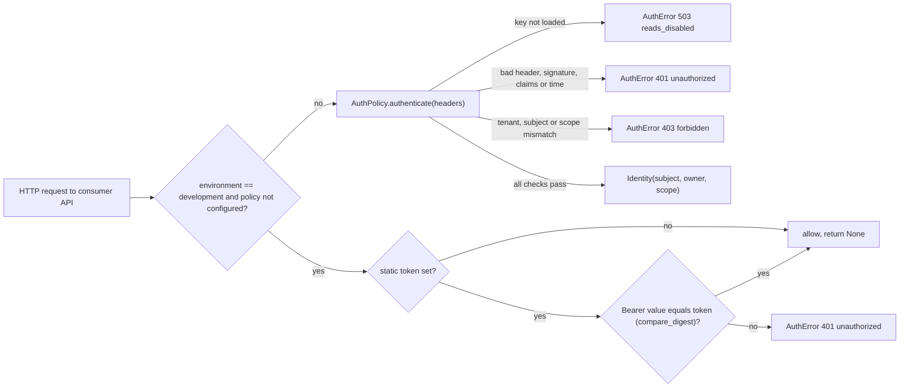
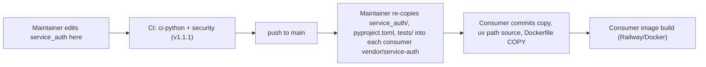

# 01 — Business process (As-Is / To-Be)

repo นี้คือ **library** Python หนึ่ง module (`service_auth/__init__.py`, package `solo-empire-service-auth` 0.1.0) ไม่มี server, CLI หรือ network call ของตัวเอง
"business process" ของ repo จึงเป็นกระบวนการของ consumer service ที่ใช้ library ตรวจ request และกระบวนการกระจาย library ไปยัง consumer (vendored copy)

## As-Is (จากโค้ดวันนี้)

### A. ตรวจ request ใน consumer service

Sources: `service_auth/__init__.py` (`check_read_auth`, `AuthPolicy.authenticate`), `tests/test_check_read_auth.py`, `tests/test_auth.py`

### B. กระจาย library ไปยัง consumer

Sources: `README.md` (บรรทัด 3–7), `PRODUCT.md` (Who uses it, Limits), `.github/workflows/ci.yml`; consumer `pyproject.toml` `[tool.uv.sources]` และ `Dockerfile` ใน worktree ของ platform-accounts-api, platform-ai-usage-api, platform-integrations-api, platform-knowledge-api, platform-saas-catalog-api (origin/main 2026-11-04)

ข้อสังเกต (As-Is): ขั้น "re-copy" ทำด้วยมือ ไม่มี script หรือ CI ตรวจ ณ origin/main ของ consumer ทั้ง 5 สำเนาไม่ตรงกับ `service_auth/__init__.py` ที่นี่ (ดู [16-deployment.md](16-deployment.md))

## To-Be

repo ไม่มี `specs/`, `docs/UPGRADE-PLAN.md` หรือ GitHub issue (`gh issue list --state all` ว่าง) และ `PRODUCT.md` บอกเฉพาะ Limits ไม่ได้บอกแผน จึงไม่วาด To-Be

Open questions:
- ทิศทางต่อจากนี้คืออะไร: คงการ vendor หรือ publish package (PyPI / git SHA pin แบบ platform-backend-core)? `DOCPACK/00-product-card.md` §8 เสนอ "สคริปต์ตรวจ drift ของสำเนา" แต่ยังไม่มีสถานะ approve
- จะ merge ส่วนที่ knowledge-api เพิ่ม (extra trusted public keys) กลับมาที่ canonical หรือไม่
- จะเพิ่ม replay protection (`jti` tracking) หรือไม่ (PRODUCT.md Limits)
