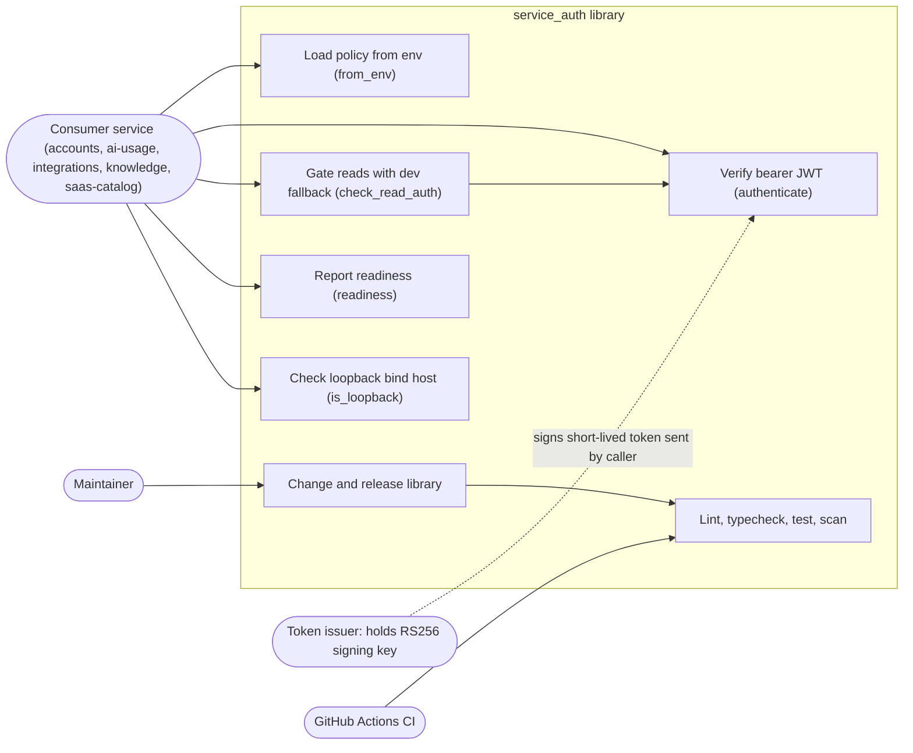

# 02 — Use cases

actors ของ library คือ **consumer services** (เรียก Python API), **token issuer** ที่ consumer ตั้งค่าไว้ (consumer README ระบุว่าเป็น Solo Web), **maintainer** และ **CI**
library ไม่มี role/auth level ภายในของตัวเอง; "auth level" ที่โค้ดรู้จักคือ claim `tenant_id == "owner"`, subject ใน allowlist และ scope เดียวต่อ policy

| Use case | Function | Result | Test |
|---|---|---|---|
| Load policy from env | `AuthPolicy.from_env(prefix, audience, required_scope)` อ่าน `<prefix>AUTH_ISSUER`, `<prefix>AUTH_PUBLIC_KEY` (แปลง `\n`), `<prefix>AUTH_SUBJECTS` (comma) | policy; `ready` เป็น true เมื่อ config ถูกทั้งหมด | `test_environment_config_and_partial_config` |
| Verify bearer JWT | `AuthPolicy.authenticate(headers)` | `Identity` หรือ `AuthError` 401/403/503 | `tests/test_auth.py` |
| Gate reads | `check_read_auth(policy, headers, environment=, token=)` | `Identity`, `None` (dev) หรือ `AuthError` | `tests/test_check_read_auth.py` |
| Readiness | `readiness(policy, environment, store)` | `(200 or 503, {status, source, auth})` | `tests/test_readiness.py` |
| Loopback check | `is_loopback(host)` | bool | `LoopbackTests` |

ค่า prefix / audience / scope ที่ consumer ใช้จริง (origin/main 2026-11-04):

| Consumer | prefix | audience | scope |
|---|---|---|---|
| platform-accounts-api (`services/accounts-metadata-api`) | `ACCOUNTS_API_` | `accounts-api` | `accounts:read` |
| platform-ai-usage-api | `AI_USAGE_API_` | `ai-usage-api` | `ai-usage:read` |
| platform-integrations-api | `INTEGRATIONS_API_` | `integrations-api` | `integrations:read` |
| platform-knowledge-api | `KNOWLEDGE_API_` | `knowledge-api` | `knowledge:read` และ `knowledge:write` (สอง policy) |
| platform-saas-catalog-api | `SAAS_CATALOG_API_` | `saas-catalog-api` | `saas:read` |

Sources: `service_auth/__init__.py`, `tests/`, `README.md`, `PRODUCT.md`; consumer `server.py` (`AuthPolicy.from_env(...)` calls) และ README ของ platform-accounts-api / platform-integrations-api (issuer = Solo Web origin)

Open questions:
- Issuer ของ knowledge-api มีหลาย key (extra keys ใน vendored copy ของมันเอง) — นอกขอบเขต library นี้
