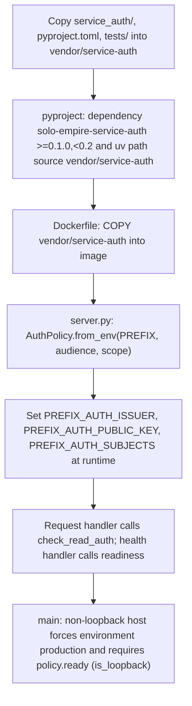
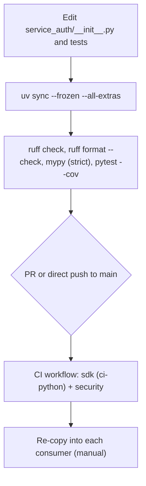
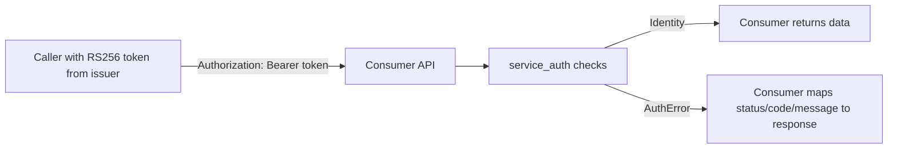

# 03 — User flows

library ไม่มี route หรือ page; "user" คือ developer ของ consumer service และ maintainer flow หลักมี 3 แบบ

## Flow 1 — Consumer นำ library ไปใช้ (adopt)

Sources: `README.md`, consumer `pyproject.toml`, `Dockerfile`, `server.py` ใน worktree ของ consumer ทั้ง 5 (origin/main 2026-11-04); พฤติกรรม non-loopback ตรวจจาก platform-integrations-api `server.py` (บรรทัด 463–467) ส่วน consumer อื่นมีการเรียก `is_loopback(args.host)` ใน `main` เช่นกันแต่ไม่ได้อ่านบรรทัดถัดไปทุกตัว

## Flow 2 — Maintainer แก้ library

Sources: `README.md` (Development), `pyproject.toml`, `.github/workflows/ci.yml`, `git log` (6 จาก 7 commit เป็น direct push, 1 ผ่าน PR #1)

## Flow 3 — Caller ส่ง request ไป consumer

Sources: `service_auth/__init__.py`; การ map `AuthError` เป็น HTTP response อยู่ใน consumer `server.py` (ไม่ใช่โค้ดของ repo นี้)
