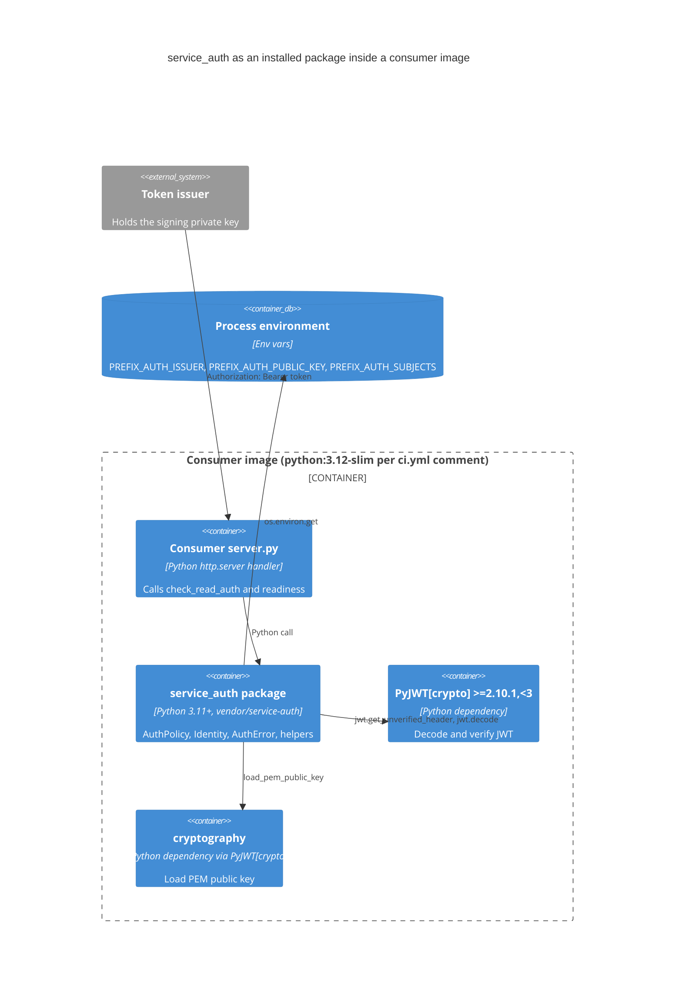

# 06 — C4 Container

"container" ของ library คือ Python package ที่ถูก copy เข้า image ของ consumer แต่ละตัว

Sources: `pyproject.toml` (`requires-python`, dependencies), `service_auth/__init__.py` (imports, `from_env`), `.github/workflows/ci.yml` (comment: consumer images python:3.12-slim), consumer `Dockerfile` (`COPY vendor/service-auth`)

หมายเหตุ: ชื่อ "http.server handler" ไม่ได้ยืนยันกับ consumer ทุกตัว — ยืนยันจากชื่อ class `IntegrationsRequestHandler` ใน platform-integrations-api `server.py` เท่านั้น
