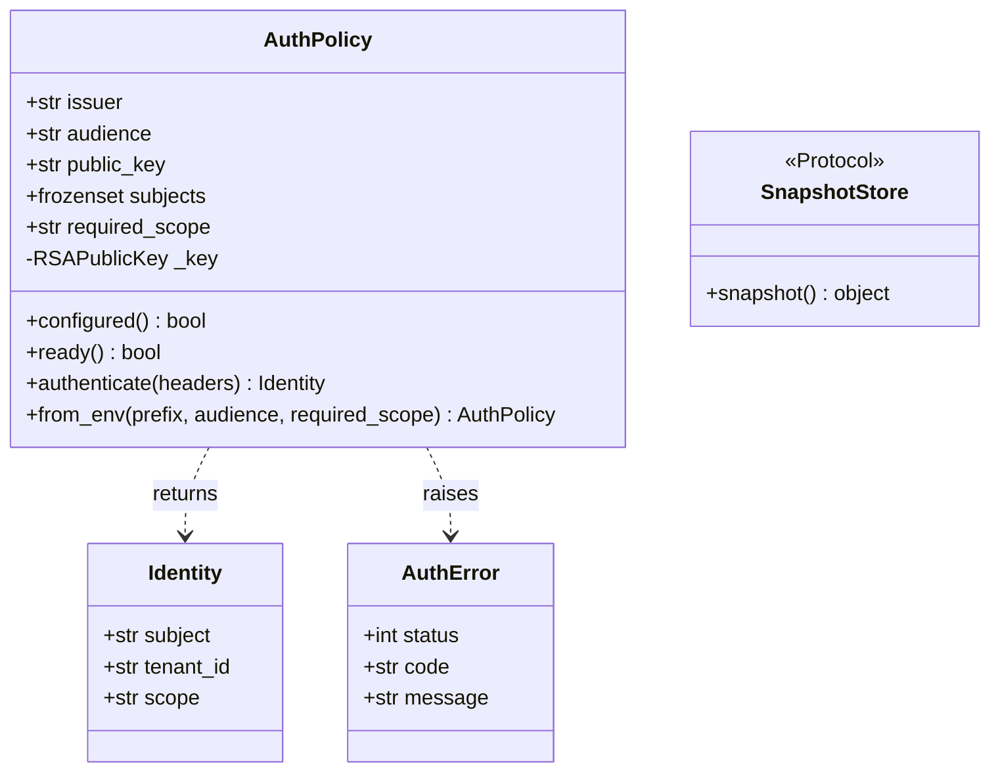

# 09 — ERD

**Status: not_applicable** — library ไม่มี persisted data: ไม่มี schema, migration, DB driver, file write หรือ storage binding ใน `service_auth/__init__.py`; ข้อมูลเดียวที่อ่านคือ env vars ใน `from_env` และ `jti` ไม่ถูกเก็บ (PRODUCT.md Limits: no replay database)
`SnapshotStore` เป็นเพียง Protocol ของ store ที่ **consumer** เป็นเจ้าของ

แทน ERD: in-memory value types ที่ library สร้าง (ไม่ถูกเก็บถาวร)

Sources: `service_auth/__init__.py`, `PRODUCT.md`
