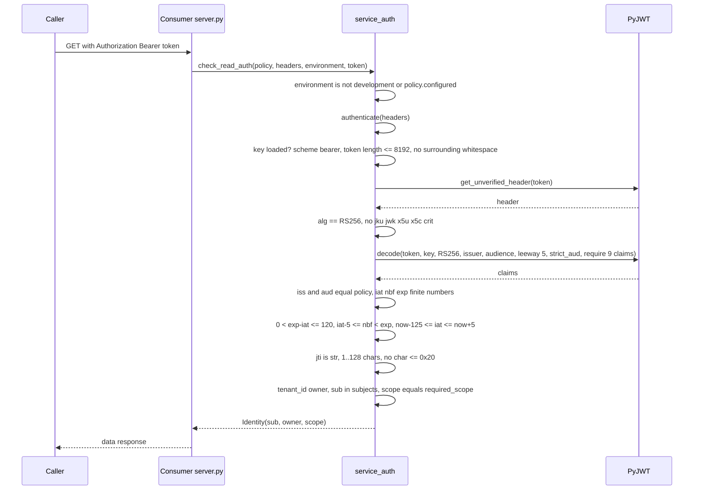
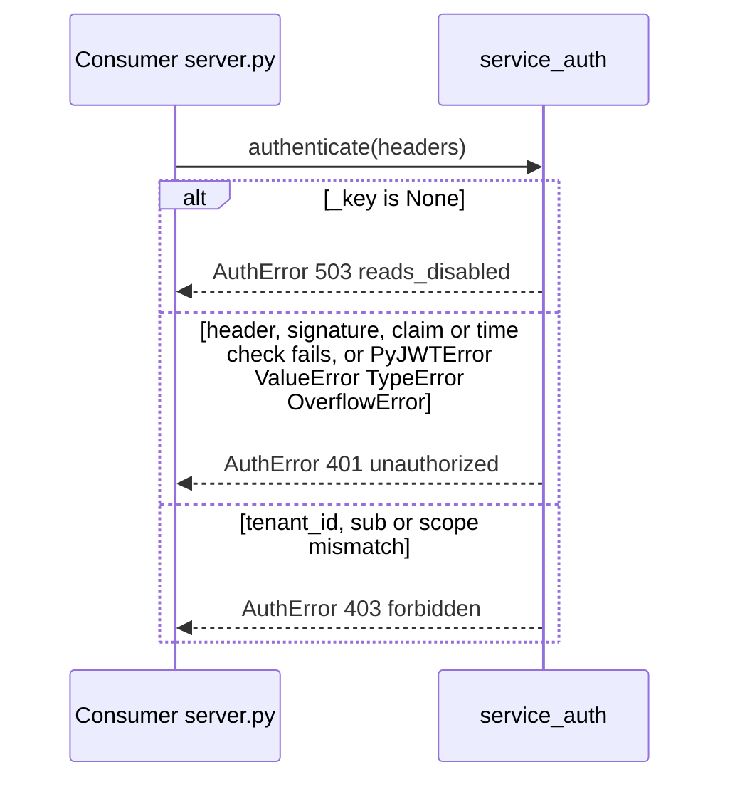
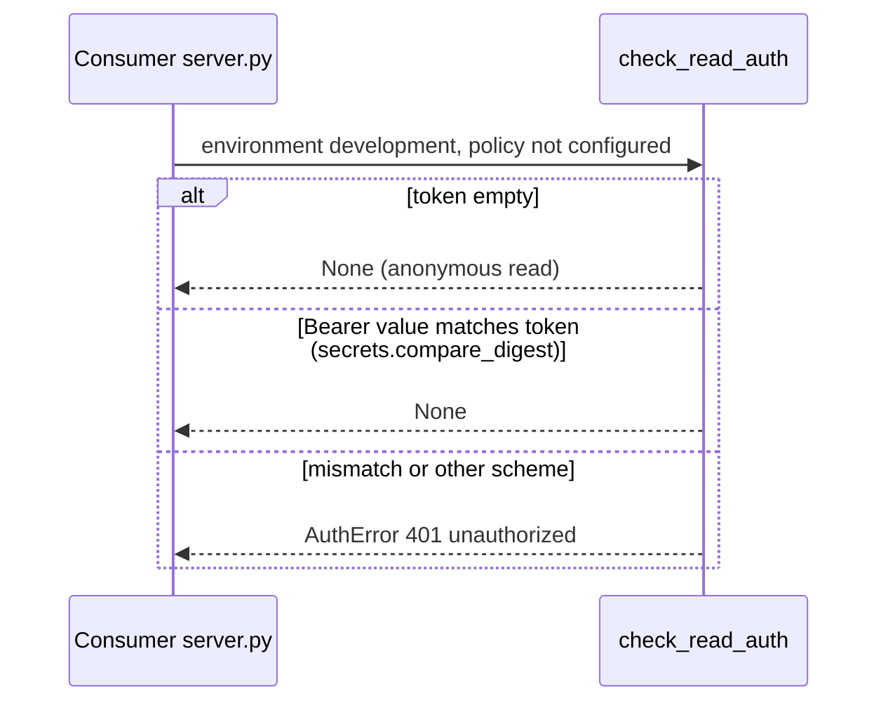
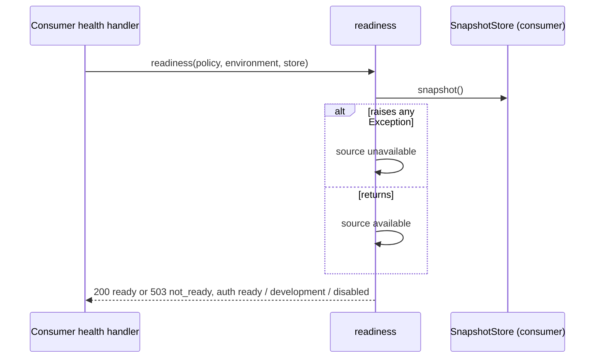

# 10 — Sequences

## 1. Production read: `check_read_auth` → `authenticate` (สำเร็จ)

## 2. Rejections

## 3. Local development fallback

หมายเหตุ: path นี้อ่าน `headers.get("authorization")` ตัวเล็กเท่านั้น ส่วน `authenticate` หา header แบบไม่สนตัวพิมพ์

## 4. Readiness

Sources: `service_auth/__init__.py`, `tests/test_auth.py`, `tests/test_check_read_auth.py`, `tests/test_readiness.py`
