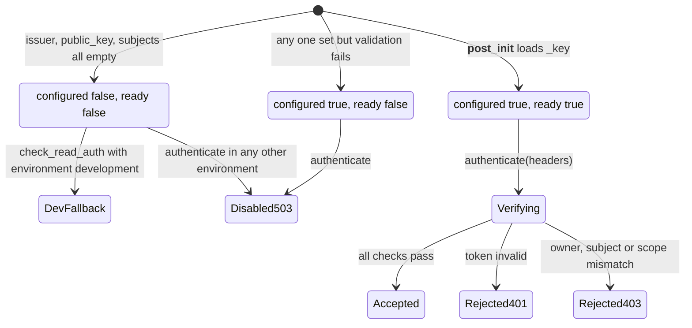
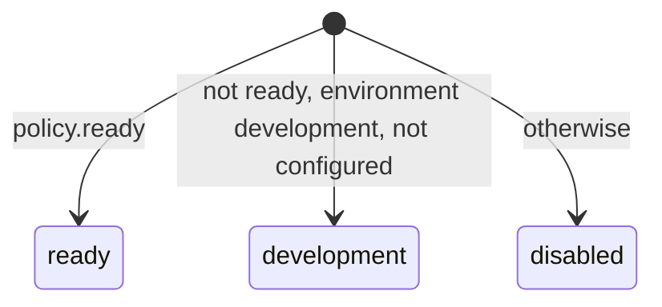

# 11 — State machines

ไม่มี entity ที่มี status field ถาวร; lifecycle ที่โค้ดมีจริงคือ **สถานะ config ของ `AuthPolicy`** (คำนวณจาก `configured` และ `ready`) และ **label `auth` ใน `readiness`**

## AuthPolicy configuration state

policy เป็น frozen dataclass: เปลี่ยนสถานะได้ด้วยการสร้าง policy ใหม่ (ปกติคือ restart consumer หลังเปลี่ยน env) เท่านั้น

## readiness `auth` label

`status` = `ready` (HTTP 200) เฉพาะเมื่อ `source == available` และ `auth == ready`; นอกนั้น `not_ready` (503) — แม้ใน development

Sources: `service_auth/__init__.py` (`configured`, `ready`, `authenticate`, `check_read_auth`, `readiness`), `tests/test_readiness.py::test_auth_state_labels`, `tests/test_auth.py::test_environment_config_and_partial_config`
