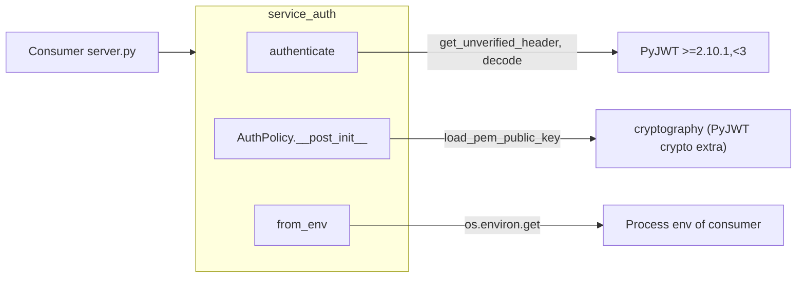

# 12 — API & integrations

library ไม่มี HTTP endpoint; API คือ public Python surface ใน `__all__`

| Symbol | Signature | Notes |
|---|---|---|
| `AuthPolicy` | `(issuer, audience, public_key, subjects, required_scope)` | frozen; `configured`, `ready` properties |
| `AuthPolicy.from_env` | `(prefix, audience, required_scope) -> AuthPolicy` | env `<prefix>AUTH_ISSUER`, `<prefix>AUTH_PUBLIC_KEY`, `<prefix>AUTH_SUBJECTS` |
| `AuthPolicy.authenticate` | `(headers: Mapping[str, str]) -> Identity` | raises `AuthError` 401/403/503 |
| `check_read_auth` | `(policy, headers, *, environment, token) -> Identity \| None` | dev-only static token |
| `readiness` | `(policy, environment, store) -> (int, dict)` | body fields `status`, `source`, `auth` |
| `is_loopback` | `(host) -> bool` | `localhost` or `ipaddress` loopback |
| `Identity`, `AuthError`, `SnapshotStore` | types | |

`AuthError` codes: `reads_disabled` (503), `unauthorized` (401), `forbidden` (403)

## Integrations

ไม่มี external network API, webhook หรือ third-party SaaS SDK; ไม่มีการดึง JWKS

Sources: `service_auth/__init__.py`, `pyproject.toml`, `uv.lock`
