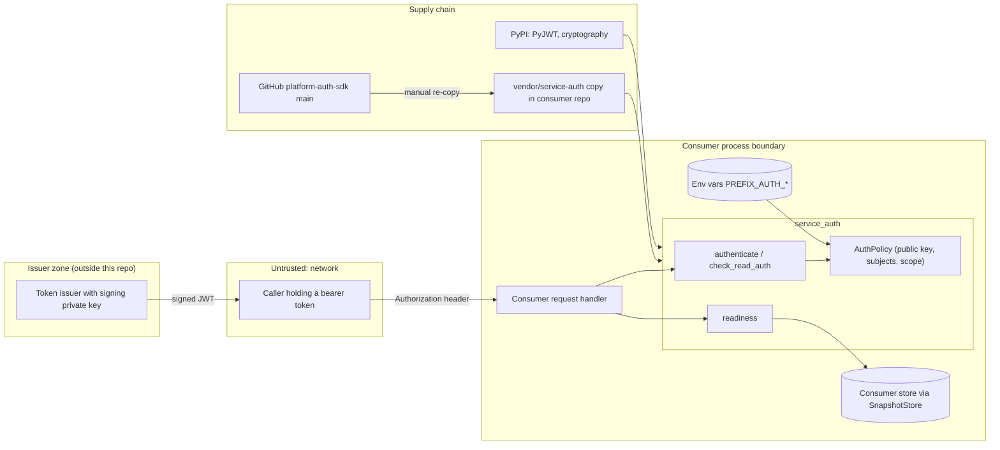

# 13 — Threat model

## DFD with trust boundaries

## STRIDE per element

| Element | Threat | Existing mitigation (code) | Gap |
|---|---|---|---|
| Bearer token (Caller → Handler) | **S**poofing: forged token | RS256 signature with local PEM key; `alg` must be RS256; HS256 rejected (test) | — |
| | **S**poofing: key injection via header | reject `jku jwk x5u x5c crit` | no test for `crit` |
| | **T**ampering: claim edits | signature; `strict_aud`; exact `iss`/`aud` re-check | re-check line 152 uncovered by tests |
| | Replay | lifetime ≤ 120 s, `iat` window now−125..now+5, `jti` required | **jti not tracked** (no replay DB, PRODUCT.md) — replay possible inside the window |
| | **E**levation: other tenant/subject/scope | `tenant_id == "owner"`, subject allowlist, exact single scope (space-separated multi-scope rejected) | — |
| | **D**oS: huge token | length > 8192 rejected before decode | — |
| AuthPolicy / env | **T**ampering/misconfig | HTTPS exact-origin issuer, RSA ≥ 2048, non-empty audience/scope/subjects, else fail closed 503 | single key only: no overlap during rotation (knowledge-api forked to add extra keys) |
| | **I**nfo disclosure of key | `public_key`, `subjects`, `_key` have `repr=False`; no private key in config | — |
| check_read_auth dev path | **E**levation: anonymous read | only when `environment == "development"` and nothing configured; `compare_digest` for static token | relies on consumer passing correct `environment`; lowercase-only `authorization` lookup in this path |
| AuthError / Identity | **I**nfo disclosure | fixed messages, `raise ... from None`, Identity drops extra claims; tests assert token not in error | — |
| readiness | **I**nfo disclosure | catches all store exceptions, returns fixed labels | — |
| Audit | **R**epudiation | — | library logs nothing; `jti`/subject logging is up to consumers |
| Vendored copy | **T**ampering / drift | README "do not edit here" note in vendor copies | **no drift check**; all 5 copies differ at origin/main 2026-11-04; no signed tags or releases |
| Dependencies | Supply chain | `uv.lock`, Renovate + vulnerability alerts, `security.yml` (gitleaks, semgrep, osv-scanner, trivy-fs) | consumers' own locks decide the installed PyJWT version |
| Repo main | **T**ampering | CI on push/PR | **no branch protection** on main (API 404) |

Sources: `service_auth/__init__.py`, `tests/*.py`, `PRODUCT.md`, `README.md`, `renovate.json`, `.github/workflows/ci.yml`, platform-ci-workflows `security.yml` @ `87dc5e1c` (jobs), `gh api repos/bookchaowalit/platform-auth-sdk/branches/main/protection`, consumer `vendor/service-auth` at origin/main

Open questions:
- ยอมรับ replay ภายใน 120 s เป็น risk ที่รับได้หรือไม่ (เป็น read-only API ส่วน knowledge-api มี `knowledge:write` scope ด้วย)
- ควรเปิด branch protection บน main หรือไม่
