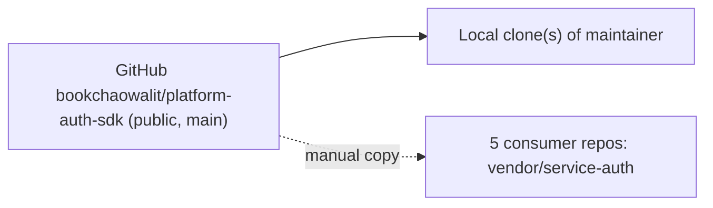

# 14 — Backup & DR

**Status: not_applicable** — library ไม่มีข้อมูล runtime ที่ต้อง backup: ไม่มี DB, file store หรือ state (`service_auth/__init__.py` ไม่เขียนอะไร) และไม่มี hosted service ให้ restore

สิ่งที่มีอยู่จริงคือ source code:

- สำเนาใน consumer เป็น "backup" โดยบังเอิญ แต่ไม่ตรงกับ canonical (ดู [16-deployment.md](16-deployment.md)) จึงใช้ restore ไม่ได้ตรง ๆ
- ไม่พบ backup workflow ใน repo; RTO/RPO: not defined
- signing / public key ไม่อยู่ใน repo (อยู่ใน env ของ consumer และ issuer) — การกู้ key เป็นเรื่องของ issuer และ consumer

Sources: `service_auth/__init__.py`, `.github/workflows/` (มีแค่ `ci.yml`), `README.md`, `gh repo view`
