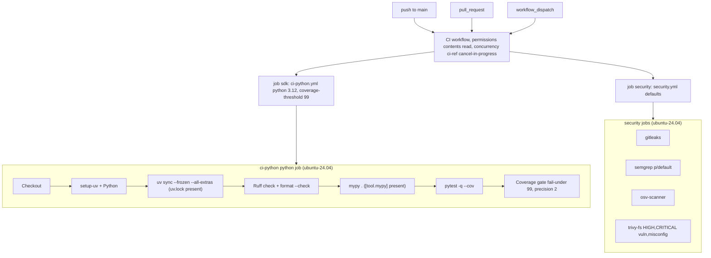

# 15 — CI/CD pipeline

workflow เดียว `CI` (`.github/workflows/ci.yml`) เรียก reusable workflows ของ `bookchaowalit/platform-ci-workflows` @ `87dc5e1c` (v1.1.1); ไม่มี CD (library ไม่มี deploy)

ทั้งสอง job รันขนานกัน (ไม่มี `needs`) Renovate (`renovate.json`) เปิด PR update ทุกจันทร์ก่อน 9 โมง (Asia/Bangkok) และ lock maintenance วันที่ 1 ของเดือน

ประวัติ run (`gh run list`): 3 runs ทั้งหมด success — PR #1 (2026-10-17), push main `ec1e2d6` (2026-10-17), push main `0907a40` (2026-10-23)

Sources: `.github/workflows/ci.yml`, platform-ci-workflows `.github/workflows/ci-python.yml` และ `security.yml` @ `87dc5e1c7e0416886a6371d5a101bb2ccba38edd` (inputs/defaults, jobs, steps), `renovate.json`, `uv.lock`, `pyproject.toml`
