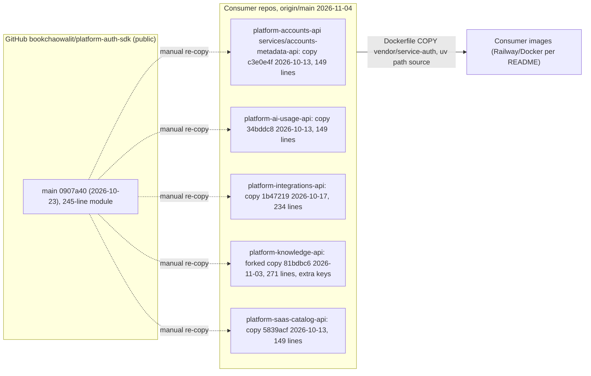

# 16 — Deployment (distribution to consumers)

library ไม่มี hosted runtime; "deployment" = consumer copy `service_auth/` เข้า `vendor/service-auth` แล้ว build image ของตัวเอง (ADR-0002 ใน [08-adr](08-adr/ADR-0002-distribute-by-vendored-copy.md))
ไม่มี git SHA pin: consumer อ้างผ่าน uv **path source** และ version range `>=0.1.0,<0.2`

| Consumer | vendored path | diff vs canonical (lines `<`/`>`) | Notes |
|---|---|---|---|
| platform-accounts-api | `services/accounts-metadata-api/vendor/service-auth` | 194 | older layout, no `SnapshotStore` |
| platform-ai-usage-api | `vendor/service-auth` | 194 | same as accounts copy |
| platform-integrations-api | `vendor/service-auth` | 23 | close: missing `SnapshotStore` and some annotations |
| platform-knowledge-api | `vendor/service-auth` | 116 | owned fork: `extra_public_key` / `<PREFIX>AUTH_EXTRA_PUBLIC_KEY` (pyproject: "this repo owns it now") |
| platform-saas-catalog-api | `vendor/service-auth` | 194 | same as accounts copy |

ความต่างที่เห็นในสามสำเนา 149 บรรทัดเป็นรูปแบบโค้ด/annotation และไม่มี `SnapshotStore`; ฟังก์ชันหลักและค่าคงที่ (RS256, `crit`, leeway 5, 120 s) ยังอยู่ — ความเท่ากันของพฤติกรรมไม่ได้พิสูจน์ด้วย test

Command used (ต่อ consumer): `git -C <consumer> show origin/main:<path>/service_auth/__init__.py | diff service_auth/__init__.py - | grep -c '^[<>]'` และ `git -C <consumer> log -1 --format='%h %cs' origin/main -- <path>`

Sources: `README.md`, `PRODUCT.md`, `pyproject.toml`; consumer `pyproject.toml`, `Dockerfile`, `vendor/service-auth/` (worktrees ใน `~/work/core22/`, origin/main 2026-11-04)

Open questions:
- consumer รุ่น production ใช้ commit ไหนของแต่ละ consumer (ไม่ได้ตรวจ deployment ของ consumer)
