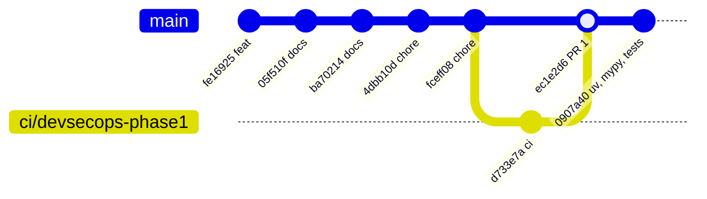
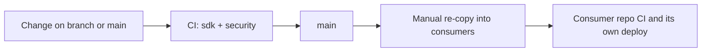

# 18 — Git & release workflow

trunk-based บน `main`; 7 commits ทั้งหมด, 1 ผ่าน PR (#1), ที่เหลือ direct push; ไม่มี tag/release; main ไม่มี branch protection

หมายเหตุ: PR #1 ใน GitHub ถูก merge แล้วเป็น commit `ec1e2d6` บน main (first-parent) — gitGraph แสดงเป็น merge เพื่ออ่านง่าย; ไม่ได้ตรวจว่า merge แบบ squash หรือ merge commit

Sources: `git log --first-parent origin/main`, `gh pr list --state all`, `gh run list` (PR head `d733e7a`), `gh api .../branches/main/protection` (404), `git tag` (empty), `README.md`
