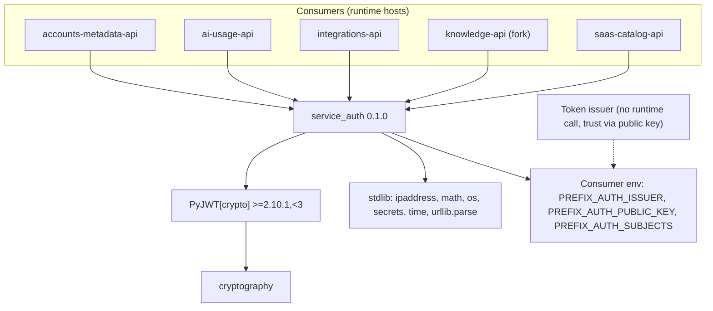

# 19 — Service dependency map

runtime dependency ของ library มีแค่ Python packages และ env ของ consumer; ไม่มี service, DB, API หรือ CDN

Dev/CI dependencies: `pytest>=8`, `pytest-cov>=6`, `mypy>=1.13`, `ruff>=0.8` (extra `dev`), uv, platform-ci-workflows v1.1.1

Sources: `pyproject.toml`, `uv.lock`, `service_auth/__init__.py` (imports), consumer `server.py`
