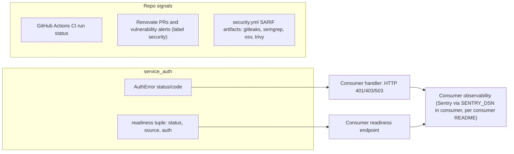

# 20 — Observability

library **ไม่มี instrumentation**: ไม่ import logging, Sentry หรือ metrics (PRODUCT.md: "Sentry is not applicable ... errors surface in the consuming services") สิ่งที่ library ส่งออกคือ signal ให้ consumer ใช้ และ signal ฝั่ง repo คือ CI/Renovate

สิ่งที่ถูกเฝ้า: ไม่มี alert channel ใน repo นี้ (ไม่มี Telegram/heartbeat/uptime) — CI failure แจ้งผ่าน GitHub notification ปกติเท่านั้น

Sources: `service_auth/__init__.py`, `PRODUCT.md` (Status), `renovate.json`, `.github/workflows/ci.yml`, platform-ci-workflows `security.yml` (upload-artifact `*-sarif`); consumer README (platform-integrations-api, platform-accounts-api: `SENTRY_DSN`)

Open questions:
- consumer log หรือ count 401/403 จาก `AuthError` หรือไม่ (ไม่ได้ตรวจ `_sentry.py` ของ consumer)
