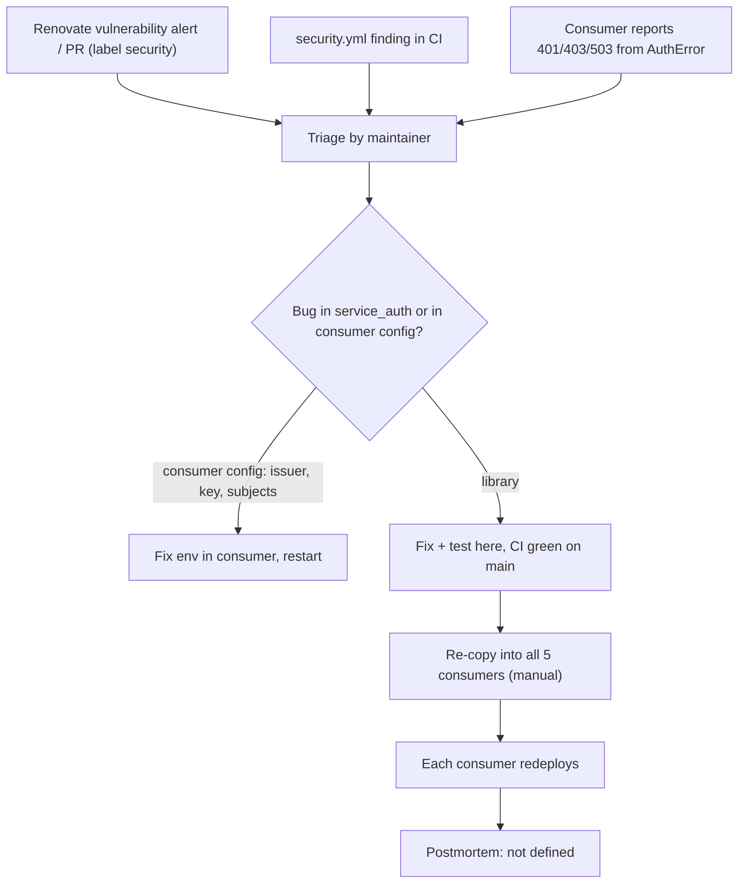

# 21 — Incident response

library ไม่มี runtime จึงไม่มี on-call alert ของตัวเอง; incident ที่เกี่ยวกับ repo นี้คือ (a) ช่องโหว่ใน library หรือ dependency และ (b) auth ล้มใน consumer flow ด้านล่างใช้เฉพาะช่องทางที่มีจริง

- ไม่มี runbook, SECURITY.md หรือ postmortem template ใน repo
- ความเสี่ยงของ flow: ขั้น re-copy ทำมือและสำเนาปัจจุบันไม่ตรงกัน (ดู [16-deployment.md](16-deployment.md)) — patch ด้านความปลอดภัยอาจไปไม่ถึงทุก consumer

Sources: `renovate.json`, `.github/workflows/ci.yml`, `README.md`, `PRODUCT.md`, `service_auth/__init__.py` (AuthError codes)

Open questions:
- ใครเป็นผู้รับ Renovate/vulnerability alert และ SLA ในการ re-copy คือเท่าไร
