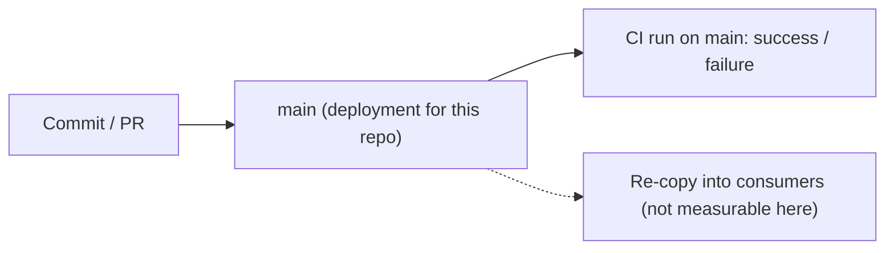

# 22 — DORA metrics

นิยามสำหรับ library: **deployment = commit ที่เข้า `main`** (สิ่งที่ consumer copy ได้) เพราะไม่มี deploy/tag; การ "ปล่อยถึง production จริง" เกิดใน consumer repo ตอน re-copy ซึ่งวัดจาก repo นี้ไม่ได้
ช่วงวัด: 90 วันถึง 2026-11-04 (`--since=2026-08-06`)

| Metric | How measured here | Value (90 d) | Command |
|---|---|---|---|
| Deployment frequency | commits on `main` first-parent | **7** (2026-10-04 → 2026-10-23), ~0.5/week | `git log --first-parent origin/main --since=2026-08-06 --oneline \| wc -l` |
| Lead time for changes | PR: created → merged; direct push: commit = deploy | PR #1: **38 min** (09:05 → 09:43 UTC 2026-10-17); 6 direct pushes ≈ 0 | `gh pr list --state all --json number,createdAt,mergedAt` |
| Change fail rate | failed CI runs on main, plus revert/fix commits | **0 / 2** main CI runs failed; **0** commits matching `^(revert\|fix\|hotfix)` | `gh run list --branch main --json conclusion`; `git log origin/main --since=2026-08-06 -i -E --grep='^(revert\|fix\|hotfix)' --oneline \| wc -l` |
| Failed deployment recovery time | time from failed main run to next green | **not computable** — no failures in window | `gh run list --json conclusion,createdAt` |
| Deployment rework rate | share of deployments that are fixes/reverts of a previous deployment | **0 / 7** | same `git log --grep` as above |

Caveats:
- CI เริ่มมีตั้งแต่ 2026-10-17 (`ec1e2d6`); 5 commits แรกไม่มี CI run จึง change fail rate จาก CI ครอบคลุมแค่ 2 deployments
- ไม่วัด propagation ไป consumer; ตัวชี้วัดที่มีประโยชน์กว่าสำหรับ library นี้คือ "copy lag" ต่อ consumer (ดู [16-deployment.md](16-deployment.md): 3 สำเนาย้อนไปที่ 2026-10-13)

Sources: `git log`, `gh pr list --state all`, `gh run list -L 50` (3 runs, all success)
